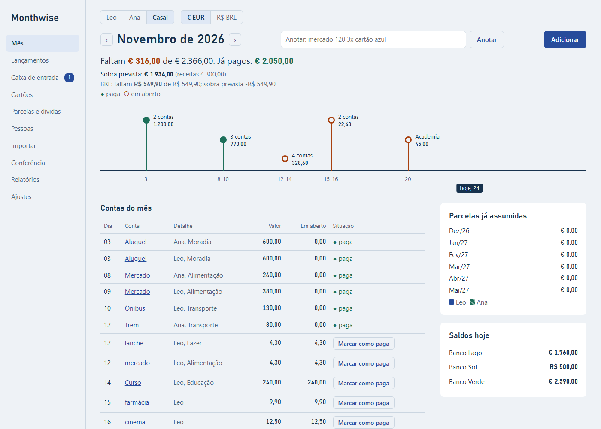
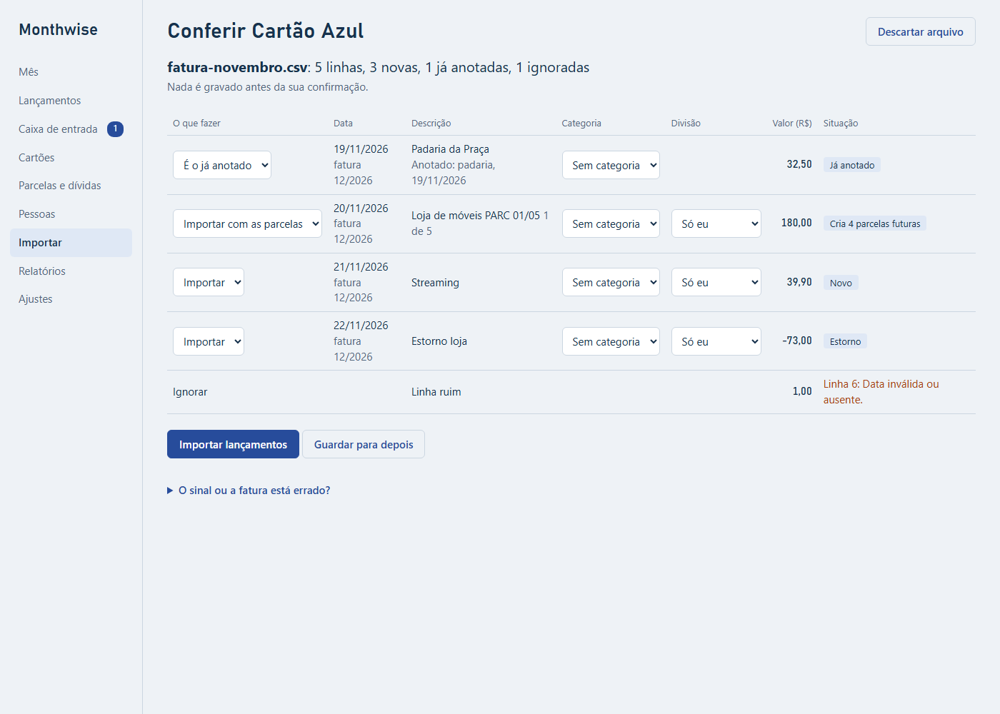
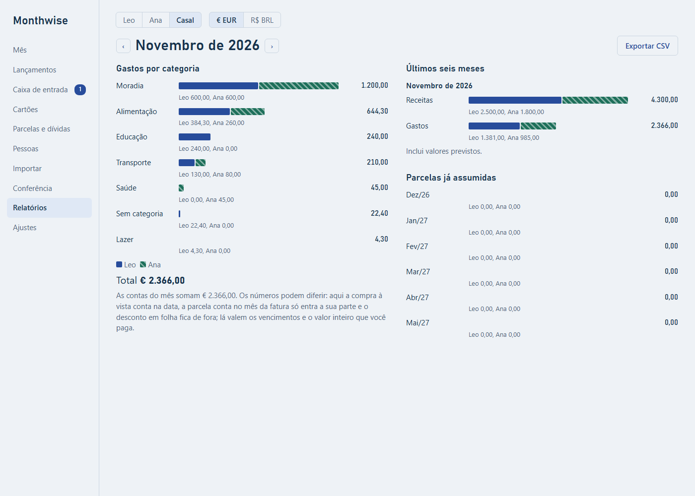

<h1 align="center">Monthwise</h1>

Finanças pessoais para Windows. 
Veja quanto falta pagar no mês e quanto dos próximos já está comprometido.

<b><a href="https://github.com/DeleONwd94/monthwise-releases/releases/latest">Baixar a versão mais recente</a></b>

> **Versão inicial.** Confira os totais com o seu banco antes de depender só do app.

## Recursos

| | |
|---|---|
| **Mês** | Contas pagas e em aberto, receitas, sobra prevista e atrasadas. |
| **Moedas** | Euro, real, dólar e libra, com totais separados e transferências entre moedas. |
| **Casal** | Visão de cada pessoa e dos dois juntos, também nos gráficos. |
| **Anotação rápida** | Escreva `mercado 12 azul`, confira o que foi entendido e salve. |
| **Contas fixas** | Aluguel, assinaturas e salário, com total por mês e por ano. |
| **Extratos** | Revolut, Wise e Banco do Brasil reconhecidos. De outros bancos, informe nome e moeda (OFX, CSV ou Excel, também em zip ou com senha). |
| **Conferência** | Junta o que você anotou com o extrato, pergunta quando há dúvida e compara o saldo com o do banco. |
| **Cartões e dívidas** | Faturas, parcelas, consignado, quitação e refinanciamento. |
| **Relatórios** | Categorias, renda e gastos por mês, parcelas futuras e exportação CSV. |
| **Backup** | Cópia diária e restauração com prévia. |

As imagens usam dados fictícios. No modo casal, o filtro organiza, mas não esconde dados de quem abrir o app no mesmo computador.

## Seus dados

- Ficam só no seu computador, em `%LOCALAPPDATA%\Monthwise`. Não há cadastro nem conexão com o banco.
- A única consulta à rede é a procura por versão nova, que pode ser desligada em Ajustes.
- O app não pede número completo de cartão, senha nem código de segurança.
- O arquivo de backup **não é cifrado** nesta versão. Guarde-o em local seguro.

## Instalação

1. Abra a [versão mais recente](https://github.com/DeleONwd94/monthwise-releases/releases/latest) e baixe `Monthwise-Setup-x.y.z.exe`.
2. Execute o instalador. Não é preciso ser administrador.
3. Abra o **Monthwise** pelo Menu Iniciar.

O instalador não tem assinatura digital, então o Windows pode mostrar um aviso. O app está em português.

O Monthwise organiza informações que você fornece e não é consultoria financeira.
