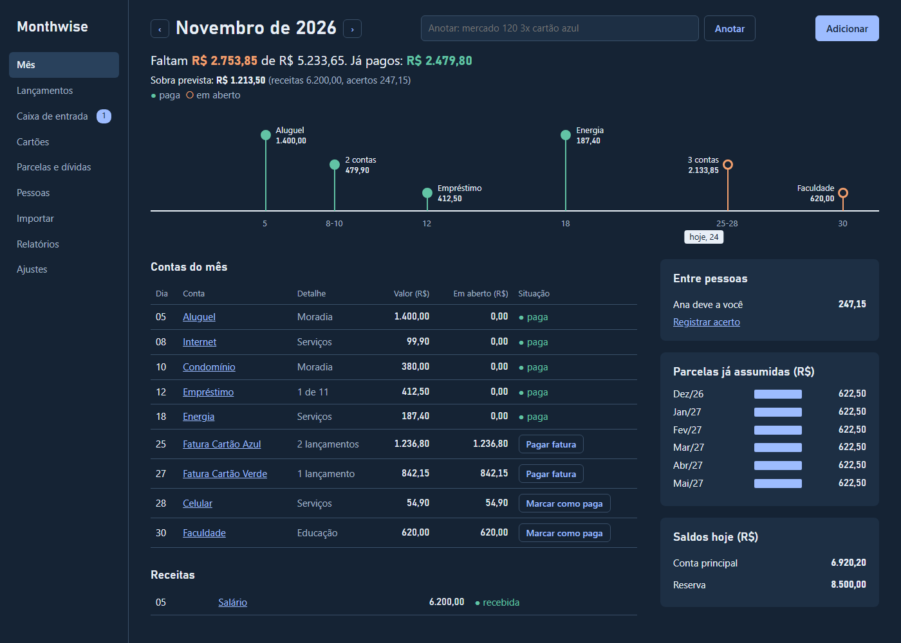

<h1 align="center">Monthwise</h1>

Finanças pessoais para Windows. 
Veja quanto falta pagar no mês e quanto dos próximos já está comprometido.

<b><a href="https://github.com/DeleONwd94/monthwise-releases/releases/latest">Baixar a versão mais recente</a></b>

> **Versão inicial.** Confira os totais com o seu banco antes de depender só do app.

## Recursos

| | |
|---|---|
| **Mês** | Contas pagas e em aberto, receitas, sobra prevista e atrasadas. |
| **Anotação rápida** | Escreva `mercado 120 3x azul`, confira o que foi entendido e salve. |
| **Cartões** | Faturas, pagamento parcial, parcelas, estornos e crédito para a fatura seguinte. |
| **Dívidas** | Cronograma, consignado, quitação antecipada e refinanciamento. |
| **Pessoas** | Divisão de gastos e acertos, inclusive em cartão de outra pessoa. |
| **Importação** | OFX, CSV e Excel, com conferência, aviso de repetidos e opção de desfazer. |
| **Relatórios** | Gastos por categoria, comparação mensal e exportação CSV. |
| **Backup** | Cópia diária e restauração com prévia. |

As imagens usam dados fictícios.

## Seus dados

- Ficam só no seu computador, em `%LOCALAPPDATA%\Monthwise`. Não há cadastro nem conexão com o banco.
- A única consulta à rede é a procura por versão nova, que pode ser desligada em Ajustes.
- O app não pede número completo de cartão, senha nem código de segurança.
- O arquivo de backup **não é cifrado** nesta versão. Guarde-o em local seguro.

## Instalação

1. Abra a [versão mais recente](https://github.com/DeleONwd94/monthwise-releases/releases/latest) e baixe `Monthwise-Setup-x.y.z.exe`.
2. Execute o instalador. Não é preciso ser administrador.
3. Abra o **Monthwise** pelo Menu Iniciar.

O instalador não tem assinatura digital, então o Windows pode mostrar um aviso. O app funciona em português e em reais.

O Monthwise organiza informações que você fornece e não é consultoria financeira.
